# Reel Storyboard: "Why half of women with painful sex stay silent"

**Creator:** Allie · Pelvic Health OT · @floorplayunfiltered
**Source:** iCloud shared album, `Teleprompter-2026-06-11_15-54-34.mp4` (1080×1920, 30 fps, 52.2 s)
**Final cut:** `output/floorplay_painful_sex_reel.mp4`, 43.5 s, 1080×1920, 30 fps, H.264/AAC

---

## 1. Techniques taken from the reference reels

**Reference A** (`instagram.com/reel/DVeRdW-E3M9`, a talking-head explainer by a social media strategist) was broken down frame by frame (cut detection, contact sheet and transcript). These techniques carry over:

| # | Technique in the reference | How it's applied here |
|---|---|---|
| 1 | **Hook headline on frame 1**: small serif line with one *italic* word, then a big caps line ("How to *increase* the views of your / DAY-IN-THE-LIFE VLOGS") | "why *half* of women with painful sex / **STAY SILENT**" on a cream brand card, shown from frame 1 so it also works as the cover |
| 2 | **No dead air**: tight jump cuts every 1–3 s | All pauses removed, plus the fumbled first take of the study line and the "Okay, so…" opener (52.2 s down to 43.5 s, 13 cuts) |
| 3 | **Punch-in zooms** on emphasis lines | 1.28× on "let that sink in", 1.18× on "not biology", 1.32× on "bad education", and subtle 1.08–1.12× resets between jump cuts |
| 4 | **Lowercase phrase captions** at chest height, a few words at a time | Inter SemiBold, cream with an olive edge, 2–4 words per phrase, keywords in brand yellow |
| 5 | **Keyword pop text** at top ("one thing", "VOICEOVER:", "it's boring.") | "let that sink in.", "let's get *into it*", "your pleasure **MATTERS TOO.**" |
| 6 | **Green-screen layout**: content in the top half, creator in the bottom half | Split screen for the research section: a cream card on top with a count-up 51% and 3×, and the video slides down below it |
| 7 | **Build-on list**: items appear one by one ("thoughts · emotion · interests…") | "many women were taught to…": 01/02/03 appear on the spoken word, then get **struck through** on "But pain isn't something you should have to normalize" |
| 8 | **End list card** in a cream rounded card over the video | CTA end card: "*if this blew your mind* / SHARE IT WITH SOMEONE WHO NEEDS TO HEAR IT" plus a FOLLOW pill |

**Reference B** (`instagram.com/reel/DeOy31bMYdl`): Instagram only serves this reel to logged-in viewers ("empty media response"), so it could not be downloaded or analysed. Re-share it as a public link, or drop the file into the repo, to fold its techniques in as well.

## 2. Brand kit applied (from your Canva designs)

Canva's API doesn't expose Brand Kit swatches directly. These values were read from your on-brand Canva designs: the "Carousel" (PELVIC HEALTH / biopsychosocial) and "Did You Know #21 – Painful Sex Myth".

| Role | Canva | Used in the reel |
|---|---|---|
| Background | `#FAF8F1` cream | Cards, split-screen panel |
| Text and rules | `#2D2B1E` dark olive | All headlines, labels, outlines, strike-throughs |
| Accent | `#F0E958` yellow (handle tag) | Highlighter marks, caption keywords, handle pill |
| Headline font | condensed serif caps | **Instrument Serif** (closest open-licence match) |
| Kicker font | handwritten script ("What your OT wants you to know about") | **Mrs Saint Delafield** |
| Label and body font | tracked sans ("PELVIC HEALTH", "SWIPE ⟶") | **Inter** Medium/SemiBold |
| Motifs | "PELVIC HEALTH" label + rule line, "01." numbering, outlined "SWIPE ⟶" pill | Name card, study label, numbered list, FOLLOW pill |

> If your Brand Kit's exact fonts differ from these stand-ins, swap the filenames at the top of `render.py` (`SERIF`, `SCRIPT`, `SANS`) and re-render.

## 3. Shot-by-shot storyboard

Times are on the **edited** timeline.

| # | Time | Frame | Audio (VO) | Visual / text | Technique |
|---|---|---|---|---|---|
| 1 | 0.0–4.1 | 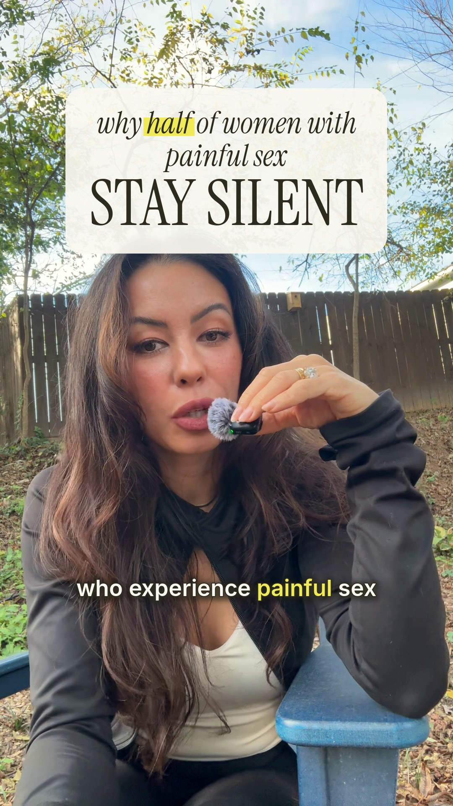 | "Almost half of women who experience painful sex never tell their partner." | Hook card: *why* <mark>half</mark> *of women with painful sex* / **STAY SILENT** (on from frame 1) | Hook headline, captions |
| 2 | 4.1–5.4 | 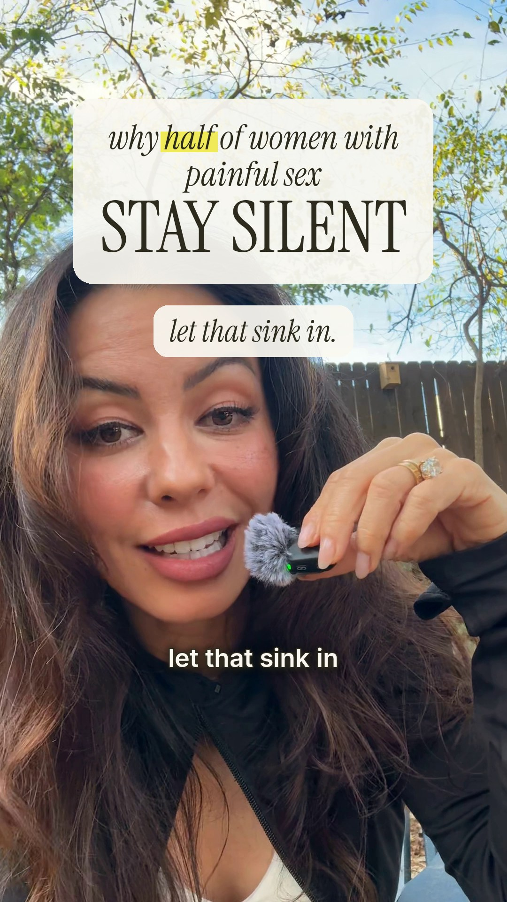 | "Let that sink in." | 1.28× punch-in, italic pop "let that sink in." | Punch-in, keyword pop |
| 3 | 5.4–8.2 | 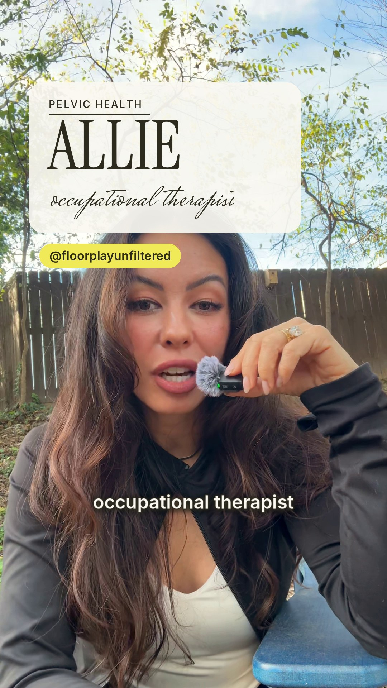 | "My name is Allie. I'm a pelvic health occupational therapist." | Name card slides in: PELVIC HEALTH rule, **ALLIE**, *occupational therapist* script, yellow @floorplayunfiltered pill | Lower-third, brand motif |
| 4 | 8.2–9.6 | 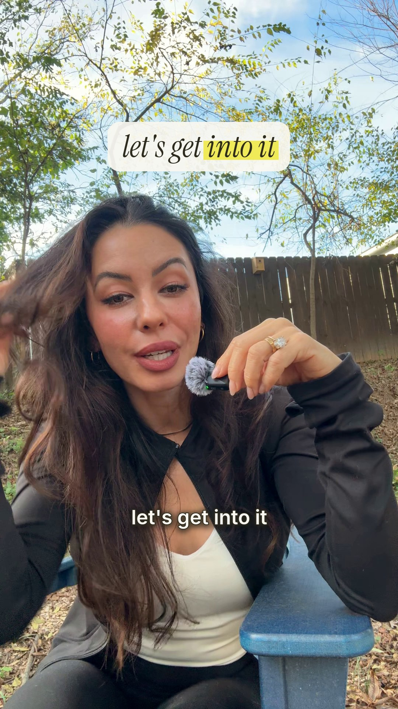 | "Let's get into it." | Pop text "let's get <mark>into it</mark>" | Keyword pop |
| 5 | 9.6–12.4 |  | "A study in the Journal of Sexual Medicine found that…" | **Split screen opens**: cream card slides down, video moves under it. Label "A STUDY IN THE JOURNAL OF SEXUAL MEDICINE", title *The Journal of* **SEXUAL MEDICINE** | Green-screen layout |
| 6 | 12.4–16.6 | 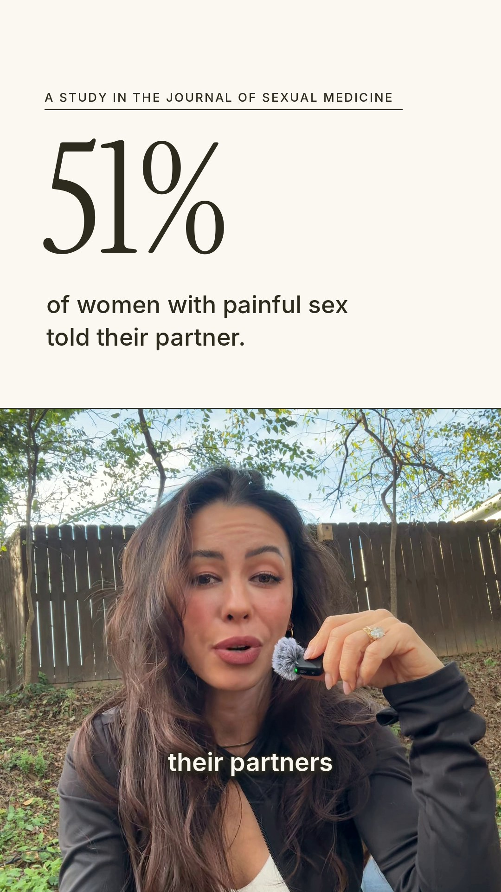 | "…only 51% of women who experienced pain during sex told their partners." | **51%** counts up from 0, sub "of women with painful sex told their partner." | Animated stat |
| 7 | 16.6–20.6 | 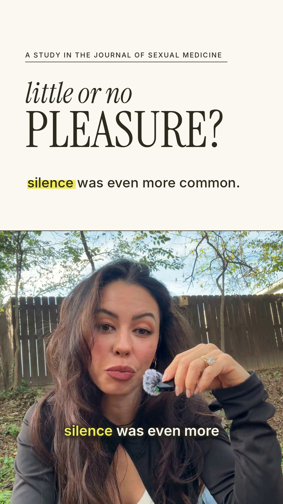 | "Among women who experienced little or no pleasure, silence was even more common." | *little or no* **PLEASURE?**, then "<mark>silence</mark> was even more common." | Stat card swap |
| 8 | 20.6–24.3 | 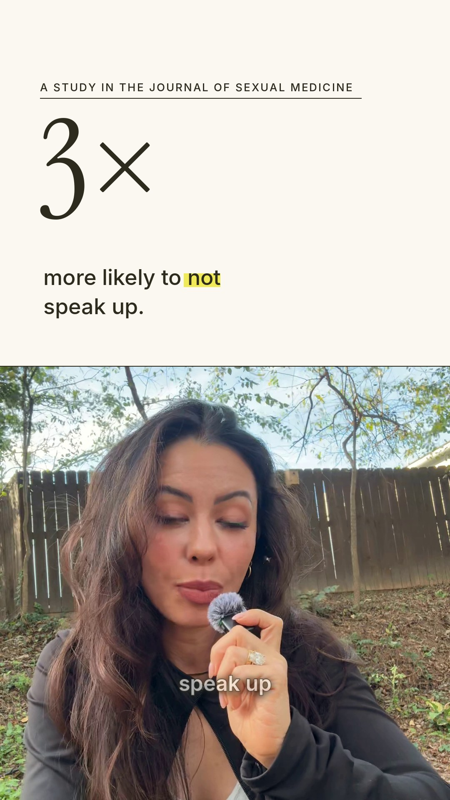 | "They were three times more likely not to speak up." | **3×** counts up, "more likely to <mark>not</mark> speak up." The split screen closes. | Animated stat |
| 9 | 24.3–30.9 | 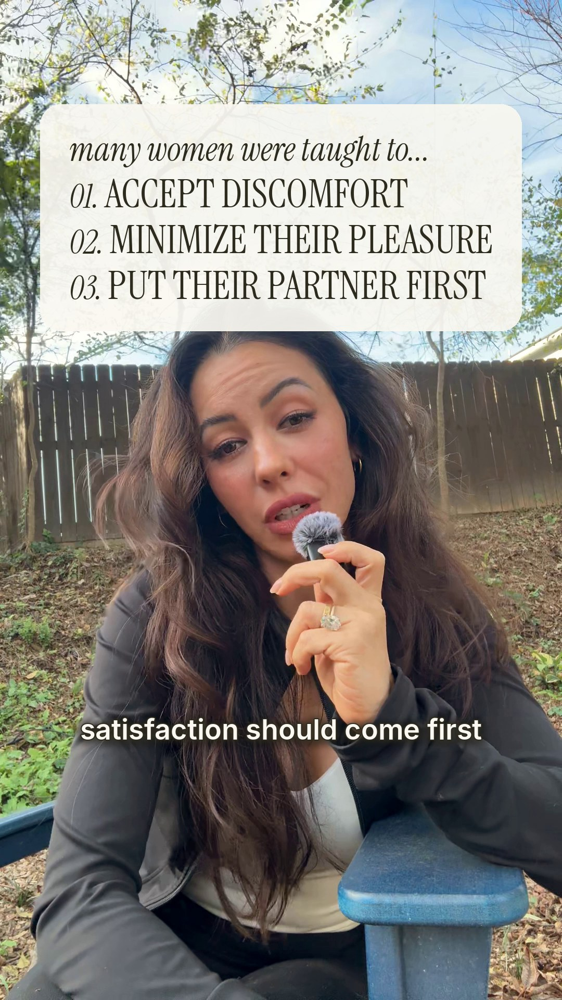 | "Many women were taught to accept discomfort as part of sex, minimize their own pleasure, or believe their partner's satisfaction should come first." | List card builds on cue: 01. ACCEPT DISCOMFORT, 02. MINIMIZE THEIR PLEASURE, 03. PUT THEIR PARTNER FIRST | Build-on list |
| 10 | 30.9–33.4 | 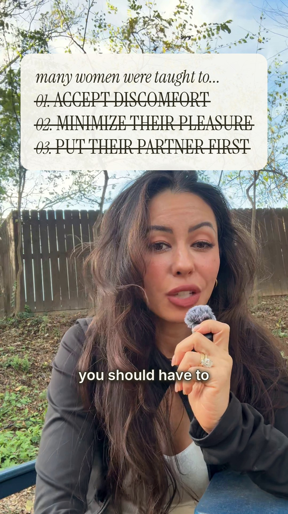 | "But pain isn't something you should have to normalize…" | Each item is struck through in turn (staggered) | List payoff |
| 11 | 33.4–35.2 | 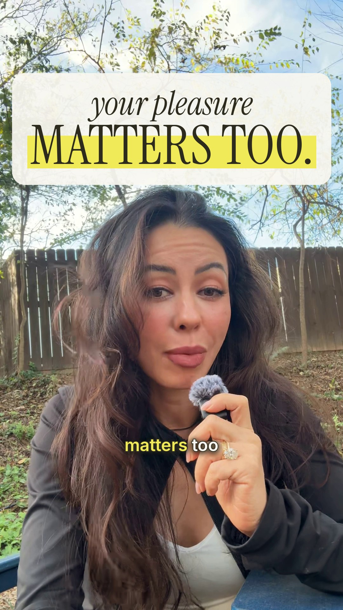 | "…and your pleasure matters too." | *your pleasure* / <mark>**MATTERS TOO.**</mark> | Keyword pop |
| 12 | 35.2–36.4 | 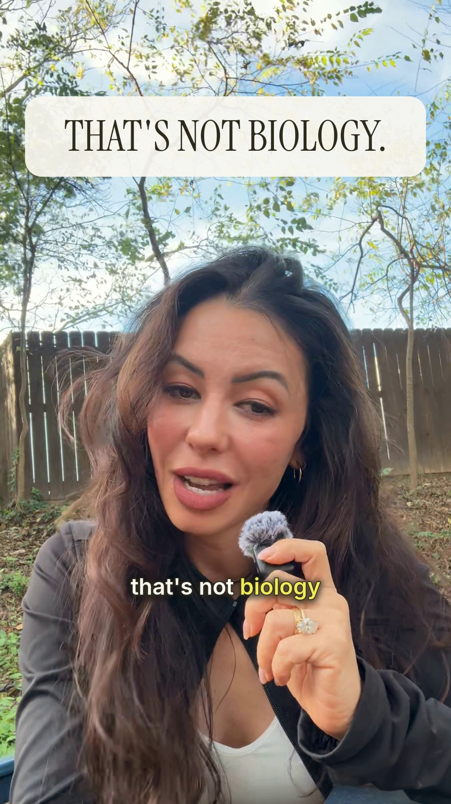 | "That's not biology." | 1.18× punch-in, **THAT'S NOT BIOLOGY.** | Punch-in |
| 13 | 36.4–37.6 | 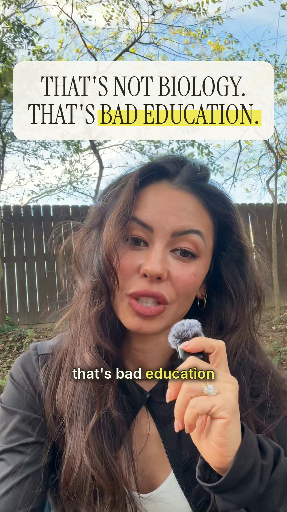 | "That's bad education." | 1.32× punch-in, line 2 **THAT'S <mark>BAD EDUCATION.</mark>** with an animated highlighter | Punch-in, marker wipe |
| 14 | 37.6–43.5 | 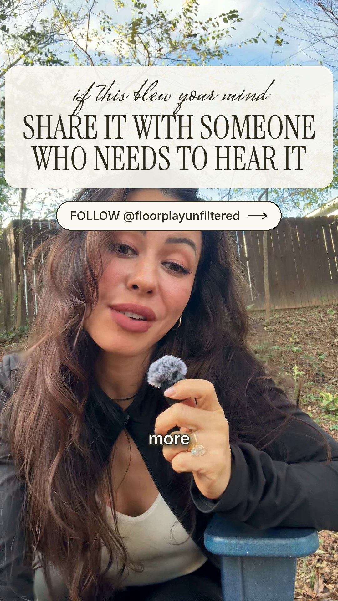 | "If this just blew your mind, share it with someone who needs to hear it, and follow for more." | End card: *if this blew your mind* / **SHARE IT WITH SOMEONE WHO NEEDS TO HEAR IT**, then outlined pill FOLLOW @floorplayunfiltered ⟶ | End card CTA |

## 4. Cut list (source → edit)

| Removed (source s) | Why |
|---|---|
| 0.00–1.30 | "Okay, so…" filler before the hook |
| 6.80–7.18, 9.92–10.30 | Breaths / dead air |
| 11.70–14.92 | Fumbled first take of "A study in the Journal of Sexual Medicine found that only…" (the second take is kept) |
| 21.86–22.18, 26.22–26.40, 30.06–30.40, 33.16–33.40, 37.10–37.30, 41.76–42.06, 44.46–45.00 | Pauses between sentences |
| 50.90–52.17 | Tail after "follow for more" |

## 5. Finishing

- Grade: +4% contrast, −6% saturation, slight warm shift to sit with the cream/olive palette
- Audio: 80 Hz high-pass, light outdoor noise reduction, loudness normalised (about −16.7 LUFS integrated)
- Safe zones: all text stays inside Instagram's UI-safe area (below the top bar, left of the action buttons, above the caption tray)
- **Music:** none is baked in, so you can add a trending or licensed track in Instagram at about 10–15% volume under the voice

## 6. Re-rendering

```bash
pip install numpy pillow
python3 reel/render.py --src Teleprompter-2026-06-11_15-54-34.mp4 --out reel/output/floorplay_painful_sex_reel.mp4
python3 reel/render.py --src Teleprompter-2026-06-11_15-54-34.mp4 --stills reel/storyboard   # stills only
```

The cut list, zooms, text and timings all live in `SEGMENTS` and `build_overlays()` in `render.py`.
